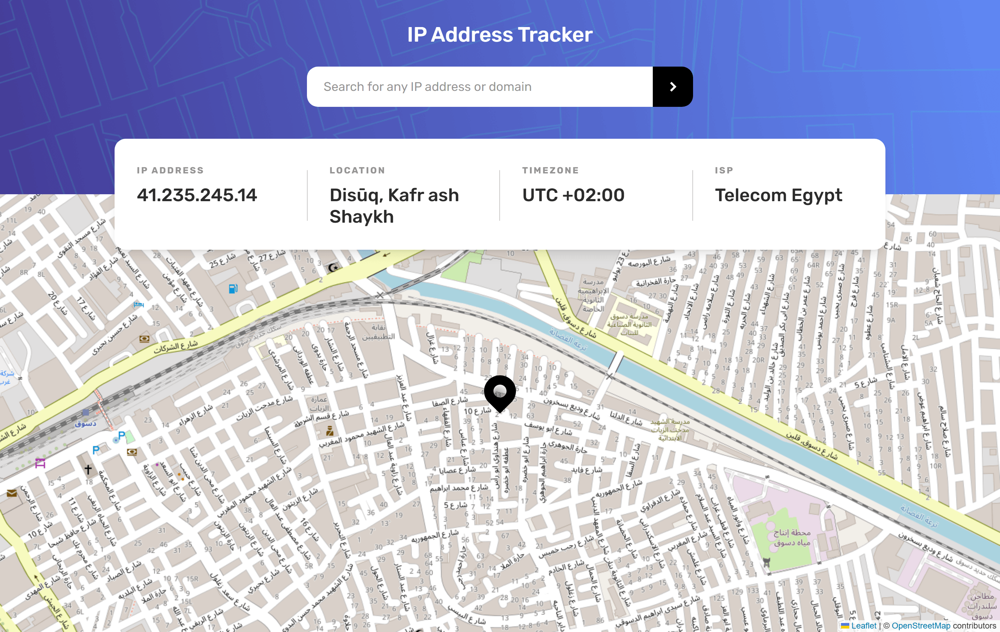
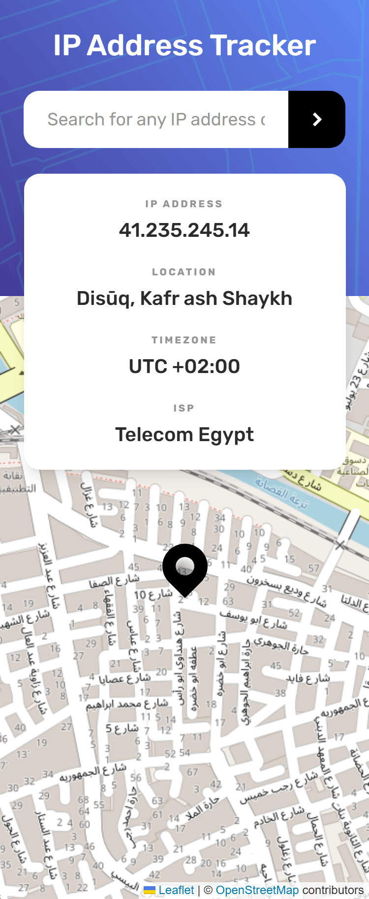

# Frontend Mentor - IP address tracker solution

This is a solution to the [IP address tracker challenge on Frontend Mentor](https://www.frontendmentor.io/challenges/ip-address-tracker-I8-0yYAH0).

## Table of contents

- [Overview](#overview)
  - [The challenge](#the-challenge)
  - [Screenshot](#screenshot)
  - [Links](#links)
- [My process](#my-process)
  - [Built with](#built-with)
  - [What I learned](#what-i-learned)
  - [Continued development](#continued-development)
  - [Useful resources](#useful-resources)
- [Author](#author)

## Overview

### The challenge

Users should be able to:

- View the optimal layout for each page depending on their device's screen size
- See hover states for all interactive elements on the page
- See their own IP address on the map on the initial page load
- Search for any IP addresses or domains and see the key information and location

### Screenshot

|                                     Desktop Design                                      |                                     Mobile Design                                     |
| :-------------------------------------------------------------------------------------: | :-----------------------------------------------------------------------------------: |
|  |  |

### Links

- [Solution URL Here](https://github.com/mustafa-abu-eisha/ip-address-tracker-ts)
- [Live Site URL Here](https://ip-address-tracker-ts-live.pages.dev/)

## My process

### Built with

- Semantic HTML5 markup
- Mobile-first workflow
- [React](https://reactjs.org/) - JS library
- [TypeScript](https://www.typescriptlang.org/) - For static type checking and robust code architecture
- [Tailwind CSS](https://tailwindcss.com/) - Utility-first CSS framework for styling
- [Vite](https://vitejs.dev/) - Frontend build tool
- [Leaflet](https://leafletjs.com/) & [React Leaflet](https://react-leaflet.js.org/) - Interactive mobile-friendly maps
- [IP Geolocation API by IPify](https://geo.ipify.org/) - Real-time IP and domain geolocation data
- [Cloudflare Pages](https://pages.cloudflare.com/) - Hosting and continuous deployment

### What I learned

Building this project with **React**, **TypeScript**, and **Tailwind CSS** was a great opportunity to practice strict type safety when handling external API responses and integrating third-party map libraries.

Key takeaways from this challenge include:

1. **Strong Typing for API Payloads:** Defining clear TypeScript interfaces for the IPify Geolocation API response ensured safe data access across components and prevented runtime undefined errors.
2. **Dynamic Map View Updates in React Leaflet:** Because Leaflet's `<MapContainer>` center prop is immutable after initialization, I created a dedicated helper component using the `useMap` hook to smoothly fly to new coordinates whenever a user searches for a new IP or domain.
3. **Responsive Floating Layout with Tailwind CSS:** Positioning the overlapping info card cleanly between the header banner and the full-height map across mobile and desktop viewports using Tailwind's utility classes and negative margins/z-index layering.

Here is an example of the TypeScript interface and map updater component I implemented:

```tsx
interface LocationTypes {
  ip: string;
  location: {
    region: string;
    city: string;
    lat: number;
    lng: number;
    postalCode: string;
    timezone: string;
  };
  isp: string;
}

// Helper component to update Leaflet map center dynamically
function ChangeView({ center }: { center: LatLngExpression }) {
  const map = useMap();
  useEffect(() => {
    map.setView(center, 17);
  }, [center, map]);
  return null;
}
```

### Continued development

In future projects, I want to continue focusing on:

- Input Validation & Regex: Enhancing client-side validation to accurately distinguish between IPv4, IPv6, and domain name formats before dispatching API requests.

- Custom Hooks & Caching: Abstracting data-fetching logic into reusable custom hooks with request caching (e.g., TanStack Query) to minimize redundant API calls and protect API rate limits.

- Accessibility (a11y): Improving screen reader announcements for dynamic map updates and live search results.

### Useful resources

- [React Leaflet Documentation](https://react-leaflet.js.org/docs/start-introduction/) - Essential guide for integrating Leaflet maps seamlessly within React components and managing map instances via hooks.
- [Tailwind CSS Documentation](https://tailwindcss.com/docs) - Helped with rapid responsive layout styling, custom background images, and z-index stacking.
- [IPify Geolocation API Docs](https://geo.ipify.org/docs) - Clear documentation on querying both IP addresses and domain names.

## Author

- [Frontend Mentor Profile](https://www.frontendmentor.io/profile/mustafa-abu-eisha)
- [GitHub Profile](https://github.com/mustafa-abu-eisha)
- [LinkedIn Profile](https://www.linkedin.com/in/mustafaabueisha)

## Acknowledgments

Thanks to Frontend Mentor for providing realistic design challenges that help improve frontend development skills through hands-on practice.
